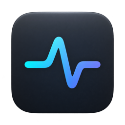
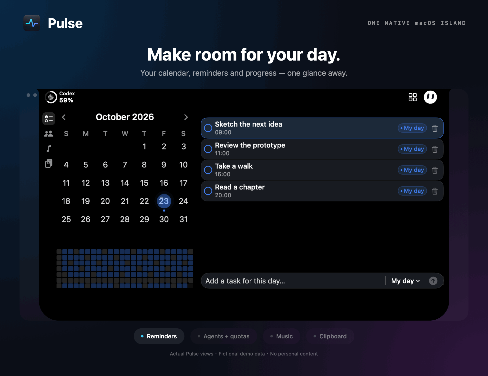

<p align="center">
  
</p>
<h1 align="center">Pulse</h1>
<p align="center">Your reminders, agents, music and everyday tools — one native macOS island.</p>
<p align="center">
  <a href="https://github.com/Crucifixion-Fxl/Pulse/releases/latest"></a>
  
  
  
</p>
<p align="center"><strong><a href="https://github.com/Crucifixion-Fxl/Pulse/releases/latest">Download the latest DMG</a></strong></p>
<p align="center">English · <a href="README.zh-CN.md">简体中文</a></p>

<p align="center"></p>
<p align="center"><sub>Choreographed from actual Pulse views and fictional demo data. No personal reminders, sessions, clipboard content or account usage. <a href="docs/images/pulse-overview.png">View the static overview</a>.</sub></p>

## Highlights

- **An island that follows you.** A compact menu-bar surface expands into a workspace on the display you are using, with notch-aware geometry and keyboard shortcuts.
- **Reminders at a glance.** Month calendar, completion heatmap, grouped day schedule, quick entry and undo. Use Apple Reminders or a private local source.
- **Agents and quotas.** Live coding sessions, attention requests and one-click session ID copying. Codex reads live quotas and local token usage, retaining the newest known quota across restarts and using newer same-window local observations when live refresh is unavailable. Other vendors are labeled sample data.
- **Make it yours.** The [extension store](docs/EXTENSION-STORE.md) controls Reminders, Agents, Music and Clipboard bars, status items, three bot characters and two voice-reactive wake effects.
- **Music and clipboard.** System Now Playing, playback controls, synced lyrics and recent clipboard history.
- **Small daily helpers.** Local weather and timed [Keep Awake](docs/adr/0014-bounded-keep-awake-sessions.md).
- **Hold Space to wake.** Black hole particles or Aurora light waves; optional [Xiaozhi voice](docs/XIAOZHI-VOICE.md). Escape ends the session. Voice runtime installation and account binding are separate.

## Download and install

1. Download `Pulse-{version}-arm64.dmg` from [Releases](https://github.com/Crucifixion-Fxl/Pulse/releases/latest).
2. Open the image and drag **Pulse.app** onto **Applications**.
3. Launch Pulse and allow Reminders access, or choose the local reminder source.

Requires **macOS 14+ on Apple Silicon**. Builds are ad-hoc signed, not Apple-notarized; macOS may require approval in **System Settings → Privacy & Security** on first launch. To verify the download, place its `.sha256` file beside the DMG and run:

```sh
shasum -a 256 -c Pulse-1.6.1-arm64.dmg.sha256
```

## Build and test

Install Xcode 26 or newer, select its developer tools, then run:

```sh
make build    # Debug app, local ad-hoc signing
make test     # macOS behavior tests and helper-script tests
make release  # Release app, ad-hoc signing and signature verification
make dmg      # dist/Pulse-{version}-arm64.dmg + .dmg.sha256
```

Builds use `/private/tmp/PulseDerivedData`; override with `DERIVED_DATA=/path`.
The first build downloads a checksum-pinned wake sound. Optional voice dependencies
are not bundled. Open `Pulse.xcodeproj` and choose the **Pulse / My Mac** scheme
for interactive development. The terminal targets need no developer certificate.

## Automated releases

Push a `vMAJOR.MINOR.PATCH` tag to build and publish the matching DMG and checksum.
The [release workflow](.github/workflows/release.yml) uses an Apple Silicon macOS
runner and the same `make dmg` path as local builds, then mounts the image to
verify its app, signature and Applications link. Manual workflow runs produce
artifacts without publishing. Main/PR builds run `make build` and `make test`.
See [release instructions](docs/RELEASING.md).

## Documentation and compatibility

[Product language](CONTEXT.md) · [Product spec](docs/PRODUCT-SPEC.md) ·
[Source layout](docs/SOURCE-LAYOUT.md) · [Architecture decisions](docs/adr)

Pulse was previously Todo Island. The bundle identifier `com.fxl.TodoIsland`
and existing data/integration locations stay unchanged, so upgrades retain
reminders, preferences and agent integrations.

## Privacy and credits

Reminder data uses EventKit or local SwiftData. Clipboard history stays on the
Mac. There is no analytics SDK. Optional voice sends microphone audio to the
selected service during an active conversation. Global hold-Space requires
Accessibility permission; in-app use does not.

The island implementation is original, informed by boring.notch's public
architecture; no GPLv3 code or artwork was copied. Keep Awake eye geometry and
motion are adapted from [Insomnia](https://github.com/krishhgg/Insomnia) (MIT).
Bundled notices are in [Pulse/Resources/Licenses](Pulse/Resources/Licenses).
