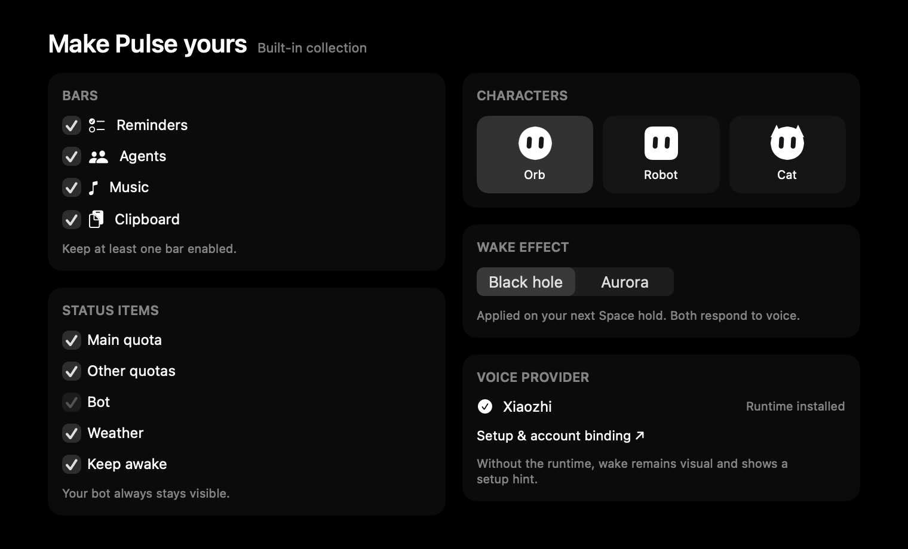

<p align="center">
  
</p>
<h1 align="center">Pulse</h1>
<p align="center">提醒事项、智能体、音乐和日常工具，汇聚于原生 macOS 灵动岛。</p>
<p align="center">
  <a href="https://github.com/Crucifixion-Fxl/Pulse/releases/latest"></a>
  
  
  
</p>
<p align="center"><strong><a href="https://github.com/Crucifixion-Fxl/Pulse/releases/latest">下载最新 DMG</a></strong></p>
<p align="center"><a href="README.md">English</a> · 简体中文</p>

<p align="center"></p>

## 主要功能

- **跟随当前屏幕的灵动岛。** 菜单栏中的紧凑状态条，点击展开原生工作区，适配刘海屏并支持键盘操作。
- **提醒事项一目了然。** 月历、完成热力图、按列表分组的日程、快速添加和撤销；支持 Apple 提醒事项及独立本地数据源。
- **智能体与额度。** 实时会话、待处理请求、一键复制会话 ID。Codex 使用实时额度与本地 token 统计，断网及重启时保留最近成功额度；其他厂商的示例数据有明确标记。
- **按喜好组合。** [扩展商店](docs/EXTENSION-STORE.md)可配置提醒事项、智能体、音乐和剪贴板功能栏，选择状态项、3 种机器人和 2 种响应语音的唤醒效果。
- **音乐与剪贴板。** 系统正在播放、播放控制、同步歌词和最近的剪贴板历史。
- **日常工具。** 本地天气、定时[保持唤醒](docs/adr/0014-bounded-keep-awake-sessions.md)。
- **长按空格唤醒。** 黑洞粒子或极光动画，可选接入[小智语音](docs/XIAOZHI-VOICE.md)。Escape 结束会话；语音运行时需单独安装和绑定账号。

## 下载与安装

1. 在[最新 Release](https://github.com/Crucifixion-Fxl/Pulse/releases/latest) 下载 `Pulse-{version}-arm64.dmg`。
2. 打开镜像，将 **Pulse.app** 拖到 **Applications**。
3. 启动 Pulse，允许访问提醒事项，或选择本地提醒数据源。

需要 **Apple Silicon Mac 和 macOS 14+**。构建使用 ad-hoc 签名，未经 Apple 公证；首次启动时，macOS 可能要求在**系统设置 → 隐私与安全性**中批准。将 `.sha256` 文件与 DMG 放在同一目录后，可验证下载完整性：

```sh
shasum -a 256 -c Pulse-1.6.0-arm64.dmg.sha256
```

## 构建与测试

安装 Xcode 26 或更新版本并选中相应开发工具后运行：

```sh
make build    # Debug 构建，本地 ad-hoc 签名
make test     # macOS 行为测试与辅助脚本测试
make release  # Release 构建、签名及验签
make dmg      # dist/Pulse-{version}-arm64.dmg 和 .dmg.sha256
```

默认构建目录为 `/private/tmp/PulseDerivedData`，可用 `DERIVED_DATA=/path` 覆盖。
首次构建会下载并校验唤醒音效，语音运行时不包含在安装包内。
也可在 Xcode 打开 `Pulse.xcodeproj`，选择 **Pulse / My Mac** 运行。
命令行构建不依赖开发者证书。

## 自动发布

推送 `vMAJOR.MINOR.PATCH` tag 后，[发布工作流](.github/workflows/release.yml)
会在 Apple Silicon macOS runner 上调用同一套 `make dmg`，挂载镜像检查应用、签名和
Applications 链接，然后将 DMG 与校验文件附加到 GitHub Release。
手动触发工作流只产出构建附件，不发布版本。main 推送和 PR 自动执行构建与测试。
详见[发布说明](docs/RELEASING.md)。

## 文档与兼容性

[产品用语](CONTEXT.md) · [产品规格](docs/PRODUCT-SPEC.md) ·
[源码结构](docs/SOURCE-LAYOUT.md) · [架构决策](docs/adr)

Pulse 原名 Todo Island，保留 `com.fxl.TodoIsland` bundle ID 及原有数据和集成目录。
升级后继续使用已有提醒事项、偏好设置与智能体集成。

## 隐私与致谢

提醒事项使用 EventKit 或本地 SwiftData；剪贴板历史保存在本机；没有分析统计 SDK。
可选语音功能仅在会话进行中向所选服务发送麦克风音频。跨应用长按空格需要辅助功能权限，
在 Pulse 内使用则不需要。

灵动岛为原创实现，参考 boring.notch 的公开架构思路，未复制 GPLv3 代码或素材。
保持唤醒的眼睛形状和动作改编自 [Insomnia](https://github.com/krishhgg/Insomnia)（MIT）。
第三方声明见 [Pulse/Resources/Licenses](Pulse/Resources/Licenses)。
